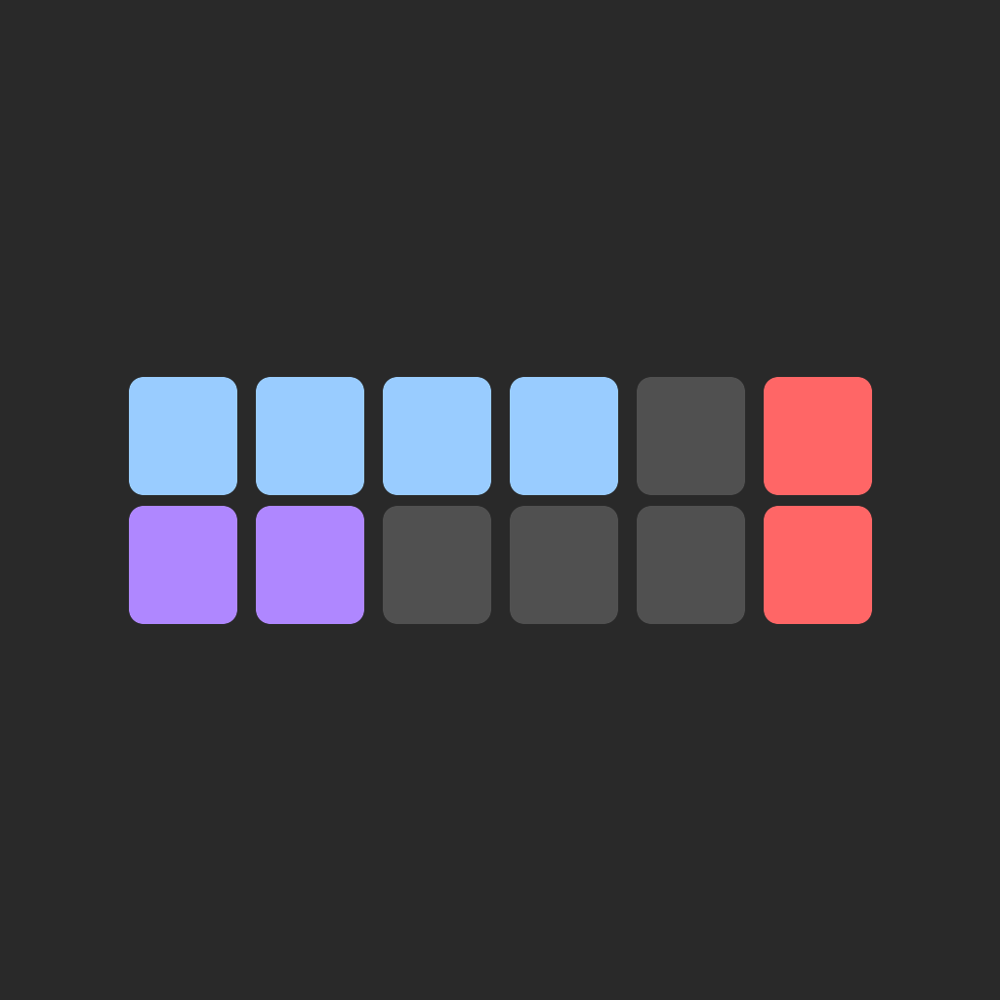
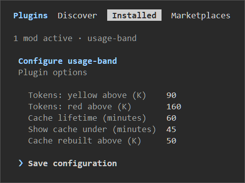

# agent-plugins


Plugins for Claude Code.

## Install

Updates follow the commit SHA on `main`. Run `claude plugin update usage-band@remsky`.

```
/plugin marketplace add remsky/agent-plugins
```

## Plugins

<details open>
<summary><b>usage-band</b> []: Claude Code Mod: live usage and cache monitoring band</summary>
<br>

```
/plugin marketplace add remsky/agent-plugins
/plugin install usage-band@remsky
```

Shows a live status of your (startup) + message token counts, time until your next 5-hour reset, a stacked 5hr/weekly limit usages, and an expiry timer on your sessions prompt cache (with a 15 minute grace period to minimize visual clutter).
- Threshold values for the the colour changes can be changed to match your workflow. 
- *If you use an API key, set cache lifetime to 5 minutes on the config screen.*

<p align="center">
  
  
</p>

</details>
