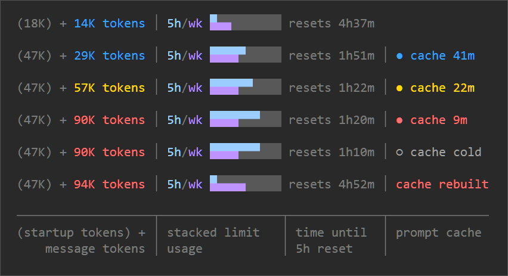

# agent-plugins


Plugins for Claude Code.

## Install

```
/plugin marketplace add remsky/agent-plugins
/plugin install usage-band@remsky
```

Updates follow the commit SHA on `main`. Run `claude plugin update usage-band@remsky`.

## Plugins

<details open>
<summary><b>usage-band</b>: Claude Code Mod: live usage and cache monitoring band</summary>

- Shows (startup) + message token counts, 5-hour limit reset timer, a stacked 5hr/weekly limit usage, and the time left on the prompt cache.
- *If you use an API key, set the cache lifetime to 5 minutes on the install screen.*

<p align="center">
  
</p>

</details>
